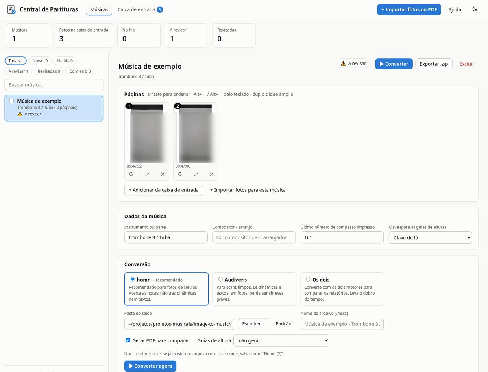
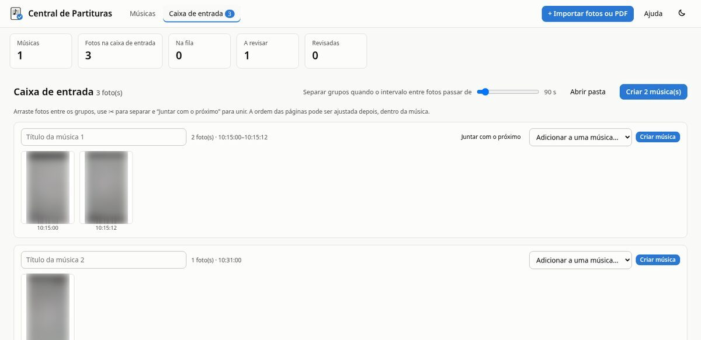
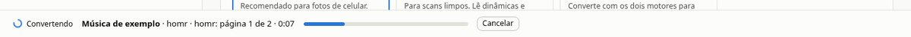
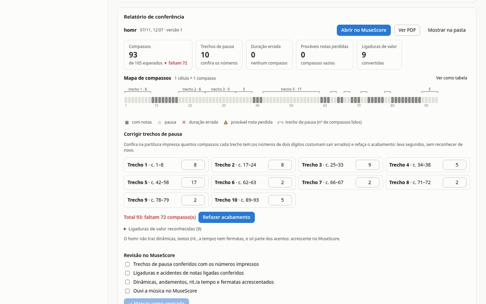
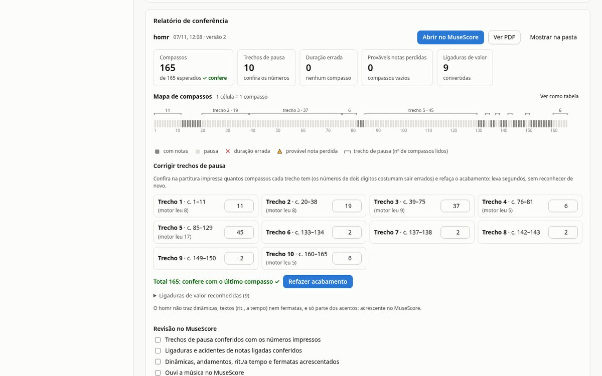

# Central de Partituras — manual de uso

A Central transforma fotos do celular (ou PDFs) de partituras em arquivos do **MuseScore** (`.mscz`), organiza as músicas e ajuda a revisar o resultado. Tudo roda no seu computador e fica na pasta do programa (a que tem o `abrir-conversor.sh`).

## 1. O que esperar

O reconhecimento automático gera um **rascunho**. A Central corrige o que dá para corrigir sozinha e aponta onde conferir; a versão final sai da sua revisão no MuseScore (ou da revisão com o Claude, seção 12).

O que mostrou o teste com uma música real (Trombone 3 / Tuba, 2 fotos, 165 compassos):

| Etapa | Resultado |
|---|---|
| Reconhecimento com o homr | 32 de 33 compassos com notas certos; pausas longas com números errados (93 compassos em vez de 165) |
| Correções automáticas da Central | ligaduras de valor e o acidente que passa pela ligadura (o compasso que faltava) |
| Você digita os números das pausas | 165 compassos e as notas iguais à versão revisada, compasso a compasso |
| Falta acrescentar no MuseScore | dinâmicas, andamentos, *rit.*/*a tempo*, fermatas e parte dos acentos |

A versão revisada usada nessa comparação foi feita por **transcrição assistida pelo Claude**, conferida compasso a compasso — nenhum programa de reconhecimento gerou aquele arquivo sozinho.

## 2. Abrir o programa

- Abra **Central de Partituras** no menu de aplicativos do GNOME, ou dê dois cliques em `abrir-conversor.sh`, na pasta do programa (ou rode esse arquivo no terminal).
- Ele abre uma janela própria. Pode fechar a janela à vontade: as conversões que estiverem na fila continuam, e um aviso aparece na área de trabalho quando terminam. Alguns minutos depois de fechar a janela (e com a fila vazia), o programa se encerra sozinho.
- **Primeira instalação** (ou num computador novo): no terminal, rode `conversor/instalar.sh`. Ele instala tudo dentro da pasta `conversor/` e pergunta se você quer o atalho no menu.

## 3. A tela principal



- **Topo**: as abas *Músicas* e *Caixa de entrada*, o botão *Importar fotos ou PDF*, a *Ajuda* (este manual) e o botão de tema claro/escuro.
- **Blocos de números**: quantas músicas, fotos esperando na caixa de entrada, conversões na fila, músicas a revisar e revisadas.
- **Lista de músicas** (esquerda): filtros por situação, busca e a caixa para selecionar várias músicas e exportar juntas.
- **Editor** (direita): tudo sobre a música escolhida — páginas, dados, conversão, relatório, revisão e histórico.
- **Fila** (rodapé): o que está convertendo agora, o progresso e o botão *Cancelar*.

A situação de cada música aparece sempre com ícone e nome:

| Situação | Significado |
|---|---|
| ○ Nova | ainda não foi convertida |
| Na fila / Convertendo | esperando ou em conversão |
| Rascunho | convertida, sem alertas — ainda precisa da sua revisão |
| ⚠ A revisar | convertida, com alertas no relatório (total de compassos, durações, notas perdidas) |
| ✓ Revisada | você conferiu e marcou como revisada |
| ✕ Erro / Cancelada / Interrompida | veja a mensagem no relatório e converta de novo |

## 4. Importar fotos ou PDF

- **Arraste** as fotos ou PDFs do gerenciador de arquivos para a janela, ou use **Importar fotos ou PDF**. Fotos HEIC do celular funcionam direto.
- Também dá para **copiar arquivos para a pasta `entrada/`**: eles aparecem sozinhos na caixa de entrada.
- A Central reconhece fotos repetidas (mesmo conteúdo) e ignora a cópia.
- Arrastar para cima das páginas de uma música adiciona as fotos direto nela.

## 5. Agrupar as fotos em músicas



As fotos ficam ordenadas pela **hora em que foram tiradas** (o celular grava isso na foto). Quando o intervalo entre duas fotos passa do limite escolhido (90 segundos, de início), a Central sugere um novo grupo — normalmente cada grupo é uma música.

- Ajuste o limite com o controle **Separar grupos quando o intervalo passar de…**.
- **Arraste** uma foto para outro grupo; use **✂** numa foto para começar um grupo novo a partir dela; **Juntar com o próximo** une dois grupos.
- **↻** gira a foto; **🗑** manda a foto para a Lixeira.
- Dê um **título** a cada grupo e clique em **Criar música** (ou **Criar N música(s)** para todos de uma vez). Para completar uma música que já existe, use **Adicionar a uma música…**.

## 6. Ordenar, girar e remover páginas

Na seção **Páginas** da música:

- **Arraste** as miniaturas para pôr na ordem certa. Pelo teclado: selecione a página e use **Alt + ←** / **Alt + →**.
- **↻** gira 90°; **⤢** (ou duplo clique) amplia; **✕** tira a página da música e devolve a foto para a caixa de entrada.
- **+ Adicionar da caixa de entrada** e **+ Importar fotos para esta música** acrescentam páginas.

## 7. Dados da música e escolha do motor

Preencha **Instrumento ou parte**, **Compositor / arranjo** e, principalmente, o **Último número de compasso impresso**: com ele a Central confere se o total de compassos bate.

| Motor | Quando usar |
|---|---|
| **homr** (recomendado) | fotos de celular: acerta as notas; não traz dinâmicas, textos nem fermatas |
| **Audiveris** | scans limpos; lê dinâmicas e textos, mas em fotos perde semibreves graves |
| **Os dois** | para comparar: converte com os dois e mostra os relatórios lado a lado (leva o dobro do tempo) |

**Guias de altura** (opcional): imagens de cada sistema com o nome das notas desenhado nas linhas suplementares (Mi2, Dó2, Lá1…). Ajudam a conferir notas graves. Usam o Audiveris (≈1 minuto a mais).

## 8. Pasta e nome de saída

- O padrão é a pasta `partituras/`. **Escolher…** abre a janela de pastas do sistema (se ela não aparecer, ela pode ter aberto atrás da Central). **Padrão** volta para `partituras/`.
- O nome sugerido é "Título - Instrumento"; você pode trocar.
- **A Central nunca sobrescreve**: se já existe um arquivo com o mesmo nome (talvez um que você editou no MuseScore), a nova versão é salva como "Nome (2)", "Nome (3)"…

## 9. Converter e acompanhar a fila

- Clique em **▶ Converter**. A música entra na fila; várias músicas são convertidas uma de cada vez.
- O rodapé mostra a etapa, a página e o tempo; **Cancelar** interrompe na hora (os motores também). Os próximos da fila têm um **✕** para sair da fila.
- Tempo típico com o homr: menos de 1 minuto para 2 páginas. A **primeira** conversão demora mais porque o homr baixa os modelos dele.
- Se o computador for desligado no meio, a música fica como *Interrompida*: é só converter de novo.



## 10. Ler o relatório e corrigir as pausas



- **Blocos de números**: total de compassos (comparado com o último compasso impresso), trechos de pausa, compassos com duração errada, prováveis notas perdidas e ligaduras de valor reconhecidas.
- **Mapa de compassos**: uma célula por compasso — cinza escuro com notas, cinza claro pausa, **✕** duração errada, **▲** provável nota perdida, e um colchete sobre cada trecho de pausa com o número de compassos lido. Passe o mouse (ou use as setas do teclado) para ver cada compasso; **Ver como tabela** mostra a mesma informação em lista.
- **Corrigir trechos de pausa**: o reconhecimento costuma errar os números de dois dígitos das pausas longas (lê "11" como "8", por exemplo). Para cada trecho, confira na partitura impressa quantos compassos ele tem e digite. O saldo mostra na hora se o total confere com o último compasso. Clique em **Refazer acabamento**: leva segundos, gera uma nova versão e não reconhece as fotos de novo.



Um trecho pode juntar duas pausas longas seguidas (por exemplo, 20 + 17 compassos aparecem como um trecho de 37): o que importa é o total do trecho.

## 11. Revisar no MuseScore

Clique em **Abrir no MuseScore** e confira com a partitura impressa ao lado:

1. **Pausas longas**: se já corrigiu os trechos (seção 10), estão certas.
2. **Ligaduras e acidentes**: a Central já converte as ligaduras de valor; confira as que ligam notas de compassos diferentes.
3. **Dinâmicas, andamentos e textos**: o homr não traz *p*, *mf*, forquilhas, *rit.*, *a tempo* e fermatas. No MuseScore, use as paletas (Dinâmicas, Forquilhas, Andamento) e **Ctrl+T** para texto de pauta.
4. **Duas vozes na mesma pauta** (ex.: Trombone 3 e Tuba): vêm como acordes. Para separar em duas pautas, use **Ferramentas → Explodir**.
5. **Ouça**: barra de espaço toca a partitura — erros de nota aparecem rápido.
6. Salve no MuseScore.

Depois marque o **checklist de revisão** na Central e clique em **✓ Marcar como revisada**: a música passa a *Revisada* e o arquivo que você revisou vira o **arquivo final** dela.

## 12. Revisão com o Claude

Para músicas importantes ou difíceis, a Central prepara tudo para uma revisão assistida — o mesmo processo que gerou a versão revisada desse teste:

1. Clique em **Preparar pacote de revisão** (≈1 minuto). O pacote tem as fotos em JPEG, as guias de altura, o rascunho listado compasso a compasso, o relatório e um `PEDIDO.md`.
2. Clique em **Copiar pedido**.
3. Abra o **Claude Code** na pasta do programa e cole o pedido.
4. O Claude escreve a transcrição em `musicas/<música>/transcricao/`, confere as durações e gera o `.mscz`; você compara o PDF com as fotos.

## 13. Exportar tudo num .zip

**Exportar .zip** (na música) ou **Exportar selecionadas** (na lista) cria um único arquivo em `exportados/` com o `.mscz` e o PDF (o arquivo revisado, se houver), e — se marcado — as fotos em ordem (`pagina-01`, `pagina-02`…), o relatório, o MusicXML, a transcrição, as guias e os registros técnicos. Nunca sobrescreve pacotes anteriores.

## 14. Dicas de captura

- O melhor é **scanner de mesa** (Simple Scan, 300–400 dpi, tons de cinza).
- Com celular: papel bem plano, luz difusa sem sombra, câmera paralela à folha, uma página por foto, a folha enchendo o quadro. O modo documento de apps como Google Drive ou Microsoft Lens ajuda.
- Fotos tiradas em sequência, uma música de cada vez, deixam o agrupamento automático certo.

## 15. Onde ficam os arquivos

| Pasta | O que tem |
|---|---|
| `entrada/` | caixa de entrada: fotos ainda sem música |
| `musicas/<música>/` | fotos (`paginas/`), conversões com relatórios e registros (`conversoes/`), pacotes de revisão e transcrição |
| `partituras/` | os `.mscz` e PDFs gerados (saída padrão) |
| `exportados/` | os pacotes `.zip` |
| `conversor/` | o programa e os motores (homr, Audiveris) — pode ser reinstalado com `instalar.sh` |
| `.estado/` | dados internos do programa |

**Backup**: copie `musicas/`, `partituras/`, `exportados/` e `entrada/`. O resto se reinstala.

## 16. Linha de comando (avançado)

Na pasta `conversor/`:

```
./converter foto1.heic foto2.heic -o "Hino.mscz" --titulo "Hino" --instrumento "Tuba" --ultimo-compasso 165 --pdf
./converter foto1.heic foto2.heic -o "Hino.mscz" --corrigir "1=11,2=19,3=37"
./converter foto1.heic -o "Hino.mscz" --motor ambos
.venv/bin/python -m unittest discover -s testes
```

`--corrigir` usa a numeração dos trechos de pausa do relatório. Uma transcrição em notação compacta gera o `.mscz` com `.venv/bin/python -m partituras.notacao arquivo.py -o saida.musicxml --mscz saida.mscz --pdf`.

## 17. Problemas comuns

- **"Sessão encerrada" ou a página não responde**: o programa foi fechado. Feche a janela e abra pelo atalho de novo.
- **A janela de escolher pasta não apareceu**: ela pode ter aberto atrás da Central; procure na barra de tarefas.
- **A primeira conversão demorou**: o homr baixa os modelos na primeira vez; as próximas são rápidas.
- **"Motor não instalado"**: rode `conversor/instalar.sh`.
- **Foto de cabeça para baixo ou deitada**: use **↻** na caixa de entrada ou nas páginas da música, antes de converter.
- **Música "Interrompida"**: o programa foi fechado durante a conversão; converta de novo.
- **Detalhes técnicos de um erro**: `musicas/<música>/conversoes/<data>/logs/` e `.estado/servidor.log`.
