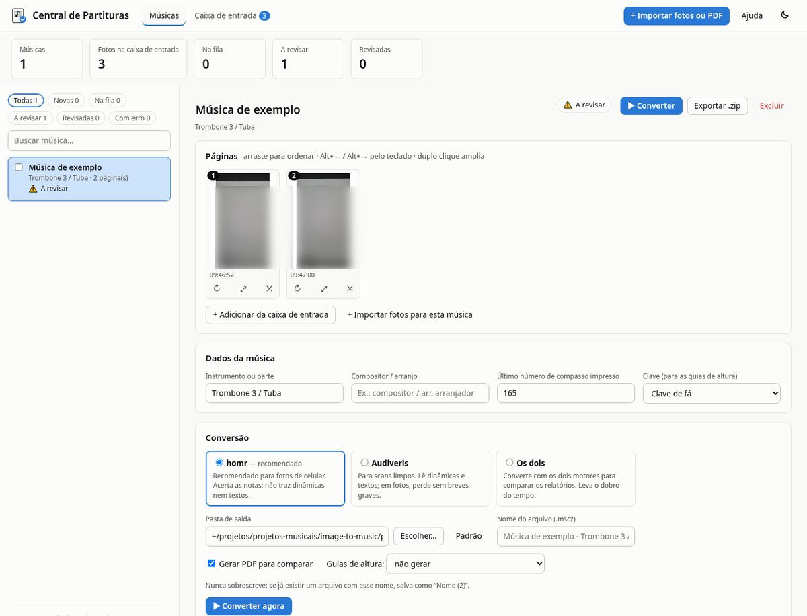

# Central de Partituras

Transforma fotos de celular (ou PDFs) de partituras em arquivos do **MuseScore** (`.mscz`). Você importa as fotos, agrupa e ordena as páginas de cada música, converte em fila com o **homr** ou o **Audiveris** e confere o resultado num relatório que aponta onde revisar. Tudo roda no seu computador.



## O que faz

- **Muitas músicas, várias fotos cada**: importa tudo de uma vez e sugere os grupos pela hora em que as fotos foram tiradas; as páginas se reordenam arrastando.
- **Conversão em fila**, com progresso e cancelamento. Nunca sobrescreve um arquivo existente: salva como "Nome (2)".
- **Correções automáticas**: ligaduras de valor (com o acidente que passa pela ligadura) e pausas longas, que você acerta em segundos digitando os números da partitura impressa.
- **Relatório** com mapa de compassos, alertas de duração errada e de nota provavelmente perdida, e checklist de revisão.
- **Extras**: os dois motores lado a lado, pacote de revisão assistida pelo Claude e exportação de tudo em `.zip`.

## Requisitos

Linux com GNOME (feito e testado no Fedora 44), Python 3, MuseScore 4 (`mscore`), ImageMagick (`magick`), poppler (`pdftoppm`), binutils (`ar`), `curl`, Google Chrome ou Chromium e zenity.

## Instalação

```bash
git clone https://github.com/felipealvss/central-de-partituras.git
cd central-de-partituras
conversor/instalar.sh
```

O instalador cria o ambiente Python (homr, Flask, waitress…), baixa o Audiveris 5.11 e os dados de OCR, tudo dentro de `conversor/`, e oferece um atalho no menu de aplicativos.

## Uso

Abra **Central de Partituras** no menu de aplicativos ou rode `./abrir-conversor.sh`. O passo a passo está no [manual](MANUAL.md), que também aparece na aba *Ajuda* do programa.

Suas fotos, músicas e partituras ficam nas pastas `entrada/`, `musicas/`, `partituras/` e `exportados/`, criadas no primeiro uso. Elas não entram no repositório.

## Para quem for mexer no código

Estrutura, linha de comando e testes: [conversor/README.md](conversor/README.md).

## Licença

Código sob a [licença MIT](LICENSE). O homr e o Audiveris, que o instalador baixa, são programas separados, com licença própria (AGPL-3.0).
